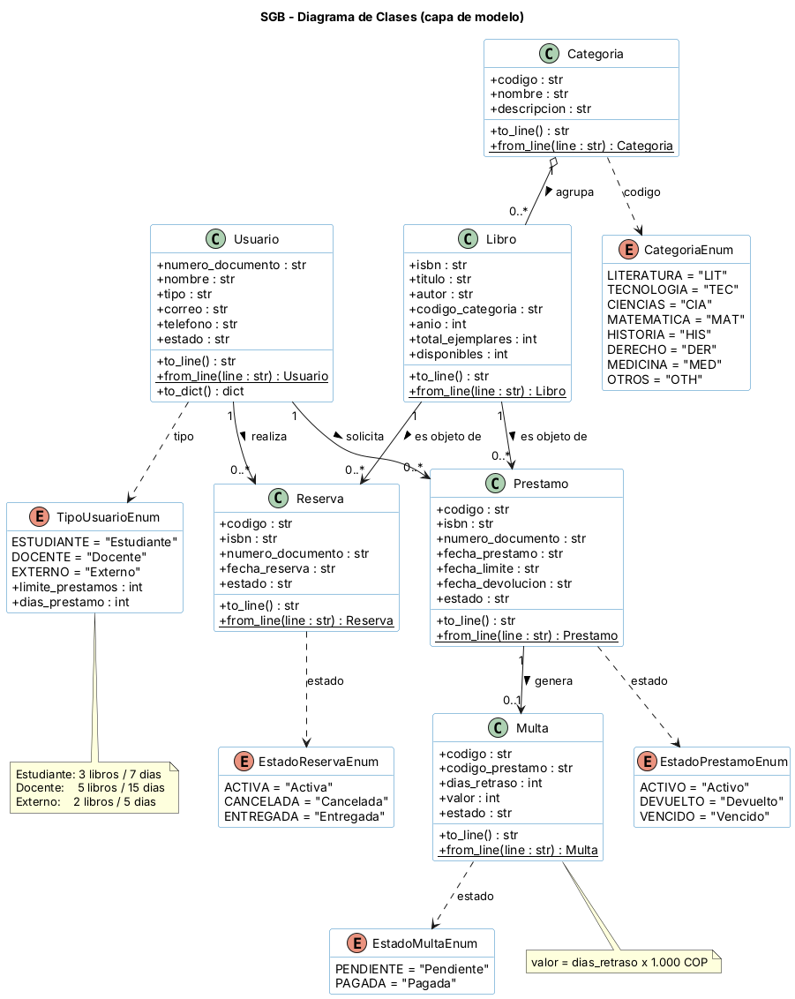
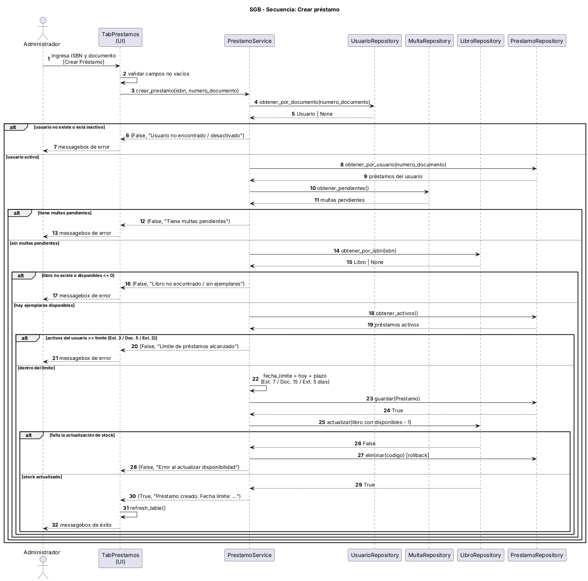
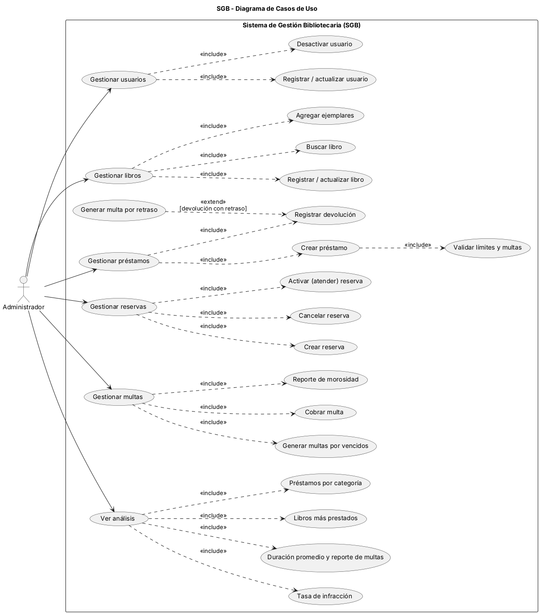

# SGB — Sistema de Gestión Bibliotecaria

**Autor:** Erick Santiago Rincon Rojas · **Código:** 01251151002
**Universidad:** UDES — Ingeniería en Ciencias de la Computación e Inteligencia Artificial
**Materia:** Programación de Computadores II (BUC372501B) · **Evaluación:** Parcial 3

---

## 1. Descripción del sistema

El SGB es una aplicación de escritorio para gestionar el ciclo completo de servicio de una biblioteca:
registro de usuarios y libros, préstamos y devoluciones, reservas, multas por retraso y análisis estadístico
del uso de la colección.

Está escrita en Python con interfaz gráfica **customtkinter**, sigue una arquitectura en **3 capas**
(Modelo → Servicios → Repositorios) y persiste sus datos en archivos de texto `.txt` delimitados por `|`.

### Funcionalidades (una pestaña por módulo)

| Pestaña | Funcionalidad |
|---|---|
| **Usuarios** | Registrar, actualizar y desactivar (soft-delete) usuarios. Clic en una fila carga el formulario. |
| **Libros** | Registrar, actualizar, eliminar, buscar por título/autor y agregar ejemplares. |
| **Préstamos** | Crear préstamos, registrar devoluciones y filtrar por Activos / Vencidos / Todos. |
| **Reservas** | Crear, cancelar y activar (atender) reservas; filtros por Activas / Todas / Usuario / ISBN. |
| **Multas** | Ver por estado o documento, cobrar, generar multas de préstamos vencidos y reporte de morosidad. |
| **Análisis** | Dashboard con KPIs, libros más prestados, préstamos por categoría, tasa de infracción y reporte de multas. |

---

## 2. Arquitectura

```
sgb-sistema-bibliotecaria/
├── main.py                  # Punto de entrada
├── requirements.txt
├── model/                   # CAPA DE MODELO (dominio)
│   ├── enums.py             #   Enumeraciones (tipos y estados)
│   └── modelos.py           #   Usuario, Categoria, Libro, Prestamo, Multa, Reserva
├── services/                # CAPA DE SERVICIOS (lógica de negocio)
│   ├── usuario_service.py   ├── libro_service.py      ├── prestamo_service.py
│   ├── multa_service.py     ├── reserva_service.py    └── analisis_service.py
├── repositories/            # CAPA DE REPOSITORIOS (persistencia)
│   ├── archivo_util.py      #   Lectura/escritura de .txt y generación de códigos
│   └── *_repo.py            #   Un repositorio por entidad
├── ui/                      # INTERFAZ GRÁFICA (customtkinter)
│   ├── main_window.py       #   Ventana principal con 6 pestañas
│   ├── tabla.py             #   Helper común para dibujar tablas
│   └── tabs_*.py            #   Una clase por pestaña
├── data/                    # Archivos de persistencia con datos de ejemplo
├── puml/                    # Diagramas PlantUML (fuente)
└── docs/                    # Esta documentación y las imágenes de los diagramas
```

**Flujo de dependencias:** `ui → services → repositories → archivos .txt`; todas las capas usan `model`.
La UI nunca accede directamente a los archivos, y los repositorios no contienen reglas de negocio.

**Convención de retorno:** los servicios que ejecutan una acción devuelven una tupla `(bool, str)`
—éxito y mensaje para mostrar al usuario—, que la UI presenta con `messagebox`.

---

## 3. Reglas de negocio

| Regla | Detalle |
|---|---|
| Cupo de préstamos activos | Estudiante = 3 · Docente = 5 · Externo = 2 |
| Plazo de préstamo | Estudiante = 7 días · Docente = 15 días · Externo = 5 días |
| Multa por retraso | **$1.000 COP por día** de retraso |
| Usuario habilitado | Debe existir y estar en estado `Activo` |
| Multas pendientes | Un usuario con multas pendientes **no puede** tomar nuevos préstamos |
| Disponibilidad | No se presta un libro sin ejemplares disponibles; al prestar baja `disponibles`, al devolver sube |
| Reservas | Solo se reserva un libro **sin** ejemplares disponibles; un usuario no puede tener dos reservas activas del mismo libro |
| Estado de reserva | `Activa` → `Cancelada` o `Entregada` (solo se cancela/atiende una reserva `Activa`) |
| Desactivación | Los usuarios no se borran: `estado = "Inactivo"` (soft-delete) |
| Préstamo vencido | Es un préstamo `Activo` cuya `fecha_limite` ya pasó; la UI lo muestra como `Vencido` |
| Multa al devolver | Si se devuelve con retraso, se crea la multa; si ya existía una generada por vencimiento, se actualiza (no se duplica) |

### Indicadores del módulo de análisis

| Indicador | Definición |
|---|---|
| Libros más prestados | Conteo de préstamos por ISBN (Top 10), con título |
| Préstamos por categoría | Conteo por categoría y porcentaje sobre el total |
| Tasa de infracción | `(préstamos con infracción / total) × 100` por tipo de usuario. Hay infracción si el préstamo sigue sin devolver pasada su fecha límite, o se devolvió después de ella |
| Duración promedio | Promedio de días entre `fecha_prestamo` y `fecha_devolucion` de préstamos devueltos |
| Reporte de multas | Cantidad y valor generado, pagado y pendiente |

---

## 4. Estructura de los datos

Carpeta `data/`. Un registro por línea, campos separados por `|`. Los códigos son secuenciales
(`PRE0001`, `MUL0001`, `RES0001`).

| Archivo | Formato de línea |
|---|---|
| `usuarios.txt` | `DOCUMENTO\|NOMBRE\|TIPO\|CORREO\|TELEFONO\|ESTADO` |
| `categorias.txt` | `CODIGO\|NOMBRE\|DESCRIPCION` |
| `libros.txt` | `ISBN\|TITULO\|AUTOR\|COD_CATEGORIA\|ANIO\|TOTAL_EJEMPLARES\|DISPONIBLES` |
| `prestamos.txt` | `CODIGO\|ISBN\|DOCUMENTO\|FECHA_PRESTAMO\|FECHA_LIMITE\|FECHA_DEVOLUCION\|ESTADO` |
| `multas.txt` | `CODIGO\|CODIGO_PRESTAMO\|DIAS_RETRASO\|VALOR\|ESTADO` |
| `reservas.txt` | `CODIGO\|ISBN\|DOCUMENTO\|FECHA_RESERVA\|ESTADO` |

Valores válidos — **Tipo:** `Estudiante`, `Docente`, `Externo` · **Estado usuario:** `Activo`, `Inactivo` ·
**Estado préstamo:** `Activo`, `Devuelto`, `Vencido` · **Estado multa:** `Pendiente`, `Pagada` ·
**Estado reserva:** `Activa`, `Cancelada`, `Entregada` · **Fechas:** `AAAA-MM-DD` ·
**Categorías:** `LIT`, `TEC`, `CIA`, `MAT`, `HIS`, `DER`, `MED`, `OTH`.
Un `FECHA_DEVOLUCION` vacío indica que el libro no ha sido devuelto.

### Datos de ejemplo incluidos

Los datos cubren los casos de prueba principales (fechas relativas al 10-nov-2026):

- 5 usuarios (2 estudiantes, 1 docente, 2 externos — uno inactivo), 8 libros en las 8 categorías.
- Préstamos activos, devueltos a tiempo, devueltos tarde y uno **vencido** (`PRE0004`) sin multa generada,
  para probar *Generar por vencidos*.
- Una multa pendiente (`MUL0001`, de Carlos Gómez → no puede pedir nuevos préstamos) y una pagada.
- El libro *Estructuras de datos en Python* está agotado y tiene 2 reservas activas.

> Para volver al estado inicial basta con restaurar los archivos de `data/`.

---

## 5. Instalación y ejecución

**Requisitos:** Python 3.10 o superior (se usan anotaciones `X | None`) y `customtkinter`.
En Linux puede hacer falta instalar tkinter: `sudo apt install python3-tk`.

```bash
pip install -r requirements.txt     # o: pip install customtkinter
python main.py
```

La ruta de `data/` se resuelve respecto al proyecto, por lo que `main.py` puede ejecutarse desde cualquier directorio.
Si no existe algún `.txt`, se trata como vacío y se crea al guardar el primer registro.

---

## 6. Diagramas UML

Los fuentes PlantUML están en `puml/` y las imágenes generadas en `docs/img/`.

| Diagrama | Archivo | Descripción |
|---|---|---|
| Clases | `puml/diagrama_clases.puml` | Entidades de dominio, enumeraciones y relaciones |
| Secuencia | `puml/diagrama_secuencia.puml` | Flujo de *crear préstamo*: validaciones, registro y actualización de stock |
| Casos de uso | `puml/diagrama_caso_uso.puml` | Funcionalidades disponibles para el Administrador |





Para regenerarlos: `java -jar plantuml.jar -tpng -o ../docs/img puml/*.puml`,
o `python puml/plantuml_url.py < puml/diagrama_clases.puml` para obtener una URL de plantuml.com.

---

## 7. Limitaciones conocidas

- La persistencia en archivos de texto no soporta concurrencia: está pensada para un solo usuario a la vez.
- Cada operación relee y reescribe archivos completos; es adecuado para el tamaño de una biblioteca académica pequeña,
  no para volúmenes grandes.
- Un préstamo vencido no cambia su estado a `Vencido` en el archivo: se calcula al consultarlo por fecha límite.
- La interfaz usa tema claro fijo.
- No hay cola de notificación de reservas: *Activar* solo marca la reserva como atendida.
